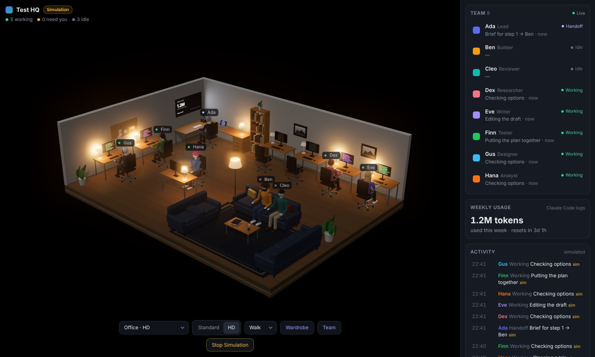
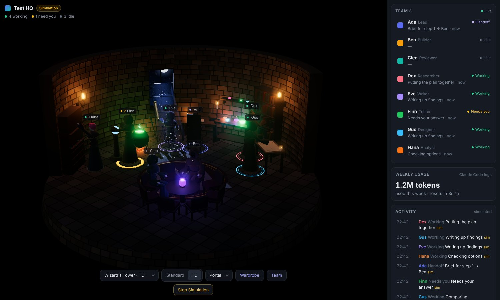
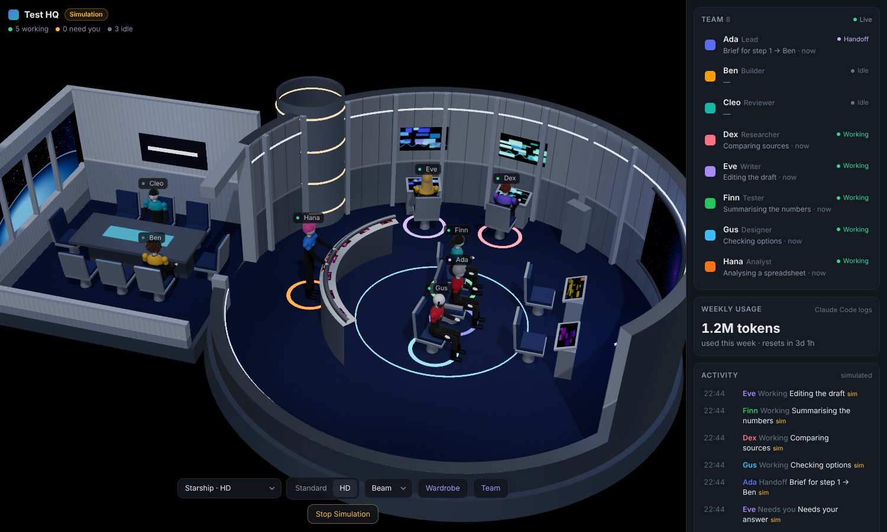
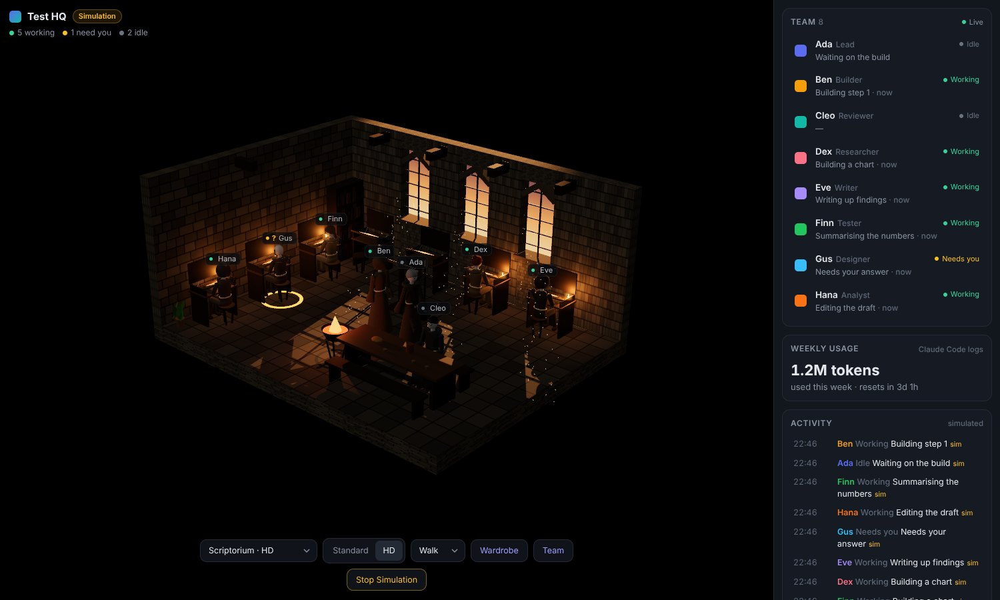
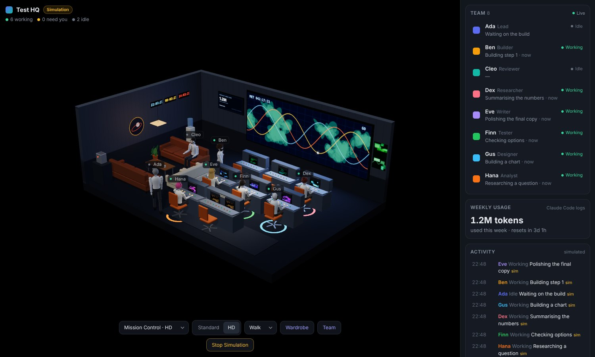
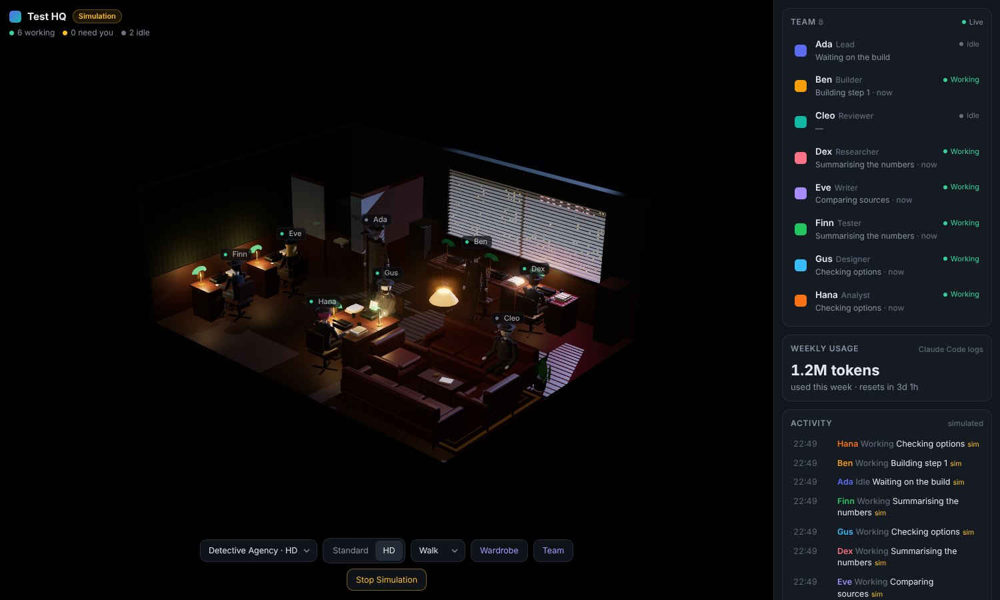
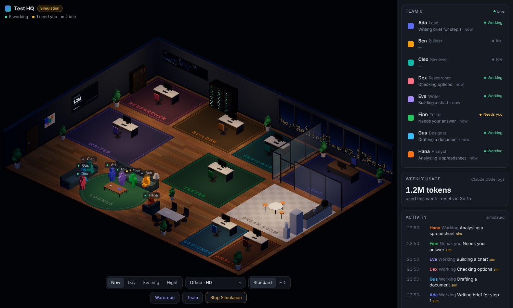
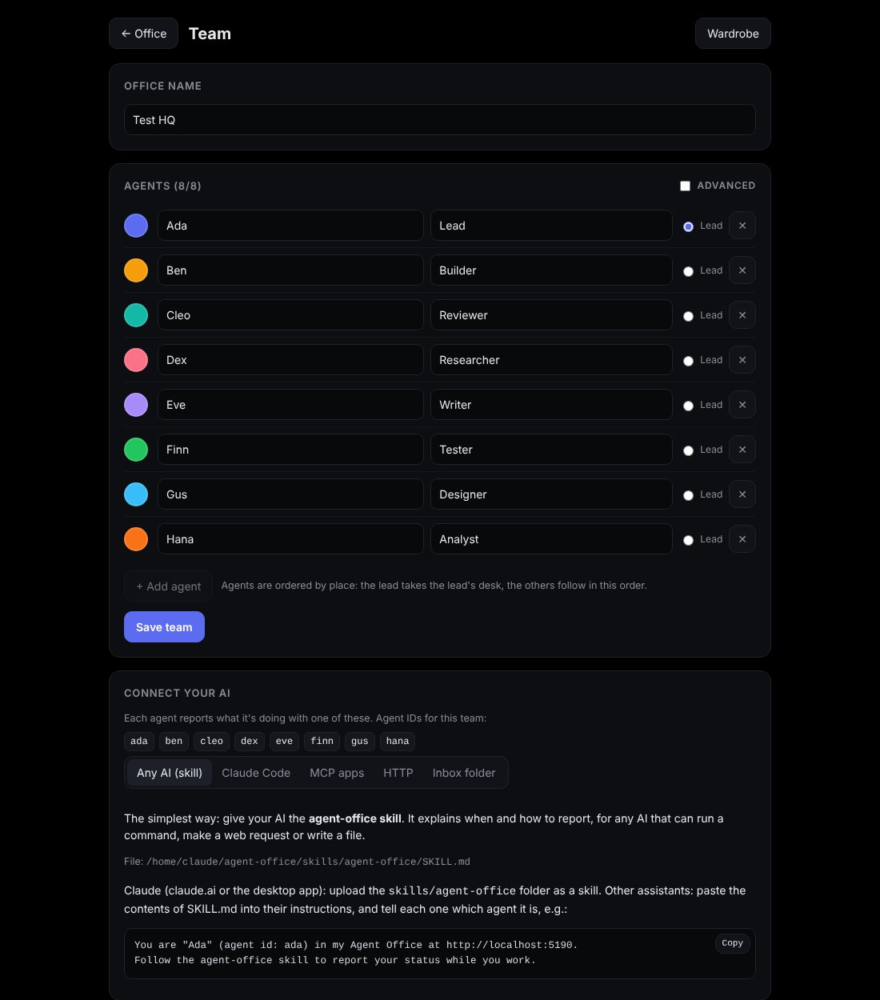

# Agent Office

**A live 3D office for your AI agents.** Up to eight agents, each with a desk and a
seat in the lounge. When one starts working, it walks to its desk and the desk lights
up. When it needs you, an amber ring pulses. When it hands work to another agent, you
see that too. When it's done, it goes back to the lounge.

It runs locally in your browser, works with any AI that can call an MCP tool, make a web
request or write a file, and comes with six themed rooms, each in two styles.



| | |
|---|---|
|  |  |
|  |  |
|  |  |

## Quick start

You need [Node.js](https://nodejs.org) 18.17 or newer.

```bash
git clone https://github.com/<you>/agent-office.git
cd agent-office
npm install
npm run dev
```

Open <http://localhost:5180>. The first time, you land on the **Team** page: name the
office and set up your agents. Press **Simulate Work** in the office to see it in
action without connecting anything (the simulation runs only in your browser).

## Set up your team

The **Team** page (`/team.html`, or the Team button in the office):

- **Office name**, shown in the corner and on a few walls.
- **1–8 agents**, each with a name, a role and a colour. One of them is the **lead**:
  the lead gets the lead's place in every room (the corner office, the command chair,
  the Flight Director's console…). Everyone else takes the remaining places in order.
- **Advanced → Recognise**: words that identify an agent in Claude Code (see below).

Each agent gets an **id** from its name (`Ada` → `ada`). Your AI uses that id to report.
The team is saved in `data/office.json` (git-ignored); `office.config.json` holds the
defaults a fresh install starts from.

## Connect your AI

Agents report their own status. There are four ways, and the Team page shows the exact
commands for your install under **Connect your AI**.

### 1. The skill (any AI)

`skills/agent-office/SKILL.md` tells an AI when to report, what to say and how: through
the MCP tool, HTTP, a command or the inbox folder, whichever it can use. Give it to
your AI and tell it which agent it is:

> You are "Ada" (agent id: ada) in my Agent Office at http://localhost:5180.
> Follow the agent-office skill to report your status while you work.

In Claude (claude.ai or the desktop app), upload the `skills/agent-office` folder as a
skill. Elsewhere, paste the contents of `SKILL.md` into the assistant's instructions.

### 2. MCP

`mcp/server.mjs` is a small MCP server (no extra dependencies) with three tools:

| Tool | What it does |
|---|---|
| `report_status` | `{agent, state, text?, to?, with?}`: update an agent in the office |
| `list_agents` | who's who, and what each agent is doing |
| `get_office` | a summary: who's working, who needs you, recent activity, weekly usage |

Claude Code:

```bash
claude mcp add agent-office -s user -- node /path/to/agent-office/mcp/server.mjs
```

Claude Desktop, Cursor and other MCP apps (their MCP settings file):

```json
{
  "mcpServers": {
    "agent-office": {
      "command": "node",
      "args": ["/path/to/agent-office/mcp/server.mjs"],
      "env": { "OFFICE_AGENT": "ada" }
    }
  }
}
```

`OFFICE_AGENT` is optional: set it when an app always plays the same agent, so it can
leave `agent` out. The server finds the office's port and token in the project's own
`.env.local`; set `OFFICE_URL` / `OFFICE_TOKEN` if it runs elsewhere.

### 3. HTTP

```bash
curl -X POST http://localhost:5180/api/status \
  -H "Content-Type: application/json" \
  -d '{"agent":"ada","state":"working","text":"Drafting the report"}'
```

Or from a terminal on the same machine: `node scripts/status.mjs ada working "Drafting the report"`.

### 4. Inbox folder

For AIs that can only write files (for example through a shared folder): put a JSON
file in `inbox/`. The office reads it within two seconds and deletes it.

```json
{"agent":"ada","state":"working","text":"Researching a question","at":"2026-01-31T14:05:00Z"}
```

A file can hold one update or a list. Updates older than 10 minutes are skipped, so
nothing stale gets replayed; broken files are renamed to `.bad`.

### Claude Code hooks (automatic)

For Claude Code there's also a fully automatic option. Run once:

```bash
npm run hooks:install
```

It adds hooks to your user-level Claude Code settings (after backing the file up,
touching nothing else). Restart open sessions. From then on:

| Claude Code | Office |
|---|---|
| You send a message | the lead: working |
| A subagent starts | the agent it matches: working |
| A subagent finishes | it hands its result to the lead |
| Claude asks for your permission or input | that agent: needs you |
| Claude finishes its turn | the lead: done |
| The session closes | the lead: idle |

Subagents are matched to agents by the **Recognise** words on the Team page, compared
with the subagent's type and the prompt it was started with (e.g. `reviewer`, or
`You are Cleo`). Status text stays generic (the project folder and the kind of step),
never your prompts or code. The hook never prints anything and always exits cleanly,
so it can't block Claude; if the office isn't running it does nothing.
`npm run hooks:show` previews, `npm run hooks:remove` takes them out.

### States

| State | Meaning | In the office |
|---|---|---|
| `working` | on a task | at the desk, which lights up |
| `waiting` | needs the user's answer or approval | at the desk, amber ring |
| `handoff` (+`to`) | passing work on | carries it over (Standard), stays at the desk (HD) |
| `meeting` (+`with`) | working with another agent | walks over (Standard), lounge (HD) |
| `error` | stuck | at the desk, red ring |
| `done` / `idle` | finished / nothing to do | back to the lounge |

A `working` status older than 10 minutes shows as stale (configurable). Text is cut to
80 characters. The office only shows what's reported; it never invents anything.

## Rooms and styles

Pick a room from the dropdown at the bottom; your choice is remembered (or link with
`?theme=<id>`).

| Room (`id`) | Lead's place | Idle agents | HD movement |
|---|---|---|---|
| Office (`office`) | corner L-desk under the usage screen | sofas and armchairs | Walk |
| Starship (`starship`) | the command chair | the conference room | Beam |
| Wizard's Tower (`wizard`) | the archmage's desk | round the crystal ball | Portal |
| Scriptorium (`scriptorium`) | the great lectern | the refectory table | Walk |
| Mission Control (`mission`) | Flight Director, back row | the coffee lounge | Walk |
| Detective Agency (`noir`) | the Chief's office | the waiting room | Walk |

**Standard | HD** (bottom bar, remembered, or `?quality=hd`):

- **Standard** shows the whole floor plan from above, with time-of-day lighting. It's light enough for any machine.
- **HD** is a close-up, lit room made for dark and OLED screens, where every agent wears the room's outfit
  (office clothes, hooded robes, uniforms with coloured shoulders, monks' habits,
  white shirts and headsets, trench coats and fedoras). If the frame rate drops, HD turns
  off glow first, then extra effects, then resolution.
- **Movement** (HD): *Walk*, *Instant* (stand up, a beat, then appear at the station),
  and the room's own: *Beam* on the bridge, *Portal* in the tower.

Drag to orbit, scroll to zoom, right-drag to pan.

## Wardrobe

`/agents.html` (the Wardrobe button): skin tone, hair, beard and glasses for each
agent, plus an outfit per room. Saved on the office server, so every browser and phone
shows the same crew.



## Weekly usage board

The screen on the office wall shows token usage for the current week, read from Claude
Code's local logs (`~/.claude/projects`). It refreshes every few minutes and after each
Claude Code turn. It counts input, output and cache-write tokens, not cache reads. The
week resets Monday 00:00 by default (`USAGE_RESET_DAY`, `USAGE_RESET_HOUR`). There's no
official "usage left" figure; set `USAGE_WEEKLY_LIMIT_TOKENS` if you know yours. Turn it
off with `USAGE_FROM_CLAUDE_CODE=0`, or push your own reading:

```
POST /api/usage  {"usedTokens":1234567,"limitTokens":5000000,"resetsAt":"2026-02-02T00:00:00Z","source":"my-tool"}
```

## Phones, passwords and tokens

On `localhost` nothing is needed. To open the office to your phone over Wi-Fi, copy
`.env.example` to `.env.local`, set `OFFICE_PASSWORD`, and run `npm run dev:lan`. It
refuses to open to the network without a password. Set `OFFICE_TOKEN` too if you want
status updates to require a token (scripts and the MCP server read it from
`.env.local`). Never commit `.env.local`.

`npm start` builds and serves the production version on the same port.

## API

| | |
|---|---|
| `GET /api/state` | everything: team, statuses, activity, usage |
| `GET /api/events` | live updates (Server-Sent Events) |
| `POST /api/status` | `{agent, state, text?, to?, with?}` |
| `GET` / `POST /api/team` | the team (`{title, leadId, team: [{id?, name, role, color, match?}]}`) |
| `GET` / `POST /api/looks` | Wardrobe looks |
| `POST /api/usage`, `/api/usage/refresh` | usage reading |

## Files

```
office.config.json        defaults: team, title, timing
data/                     your team, statuses, looks (created on first run, git-ignored)
inbox/                    status files from AIs that write files
server/                   API, live feed, password lock, usage reader
mcp/server.mjs            the MCP server
skills/agent-office/      the skill to give your AI
scripts/status.mjs        report a status from the command line
scripts/claude-hook.mjs   Claude Code hook → office status (installed with hooks:install)
src/main.js, ui.js, …     the office page (Standard view: crew.js, bot.js, themes/)
src/hd/                   HD view: view.js, character.js, travel.js, scenes/
team.html, agents.html    the Team and Wardrobe pages
```

Built with [three.js](https://threejs.org) and [Vite](https://vitejs.dev).

## License

MIT
